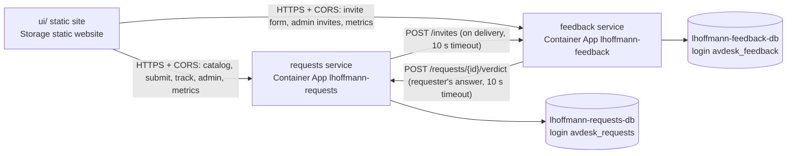
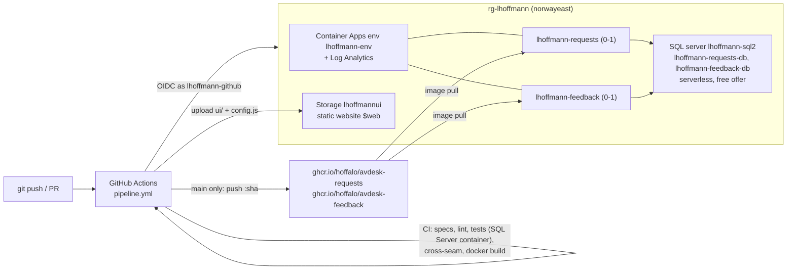
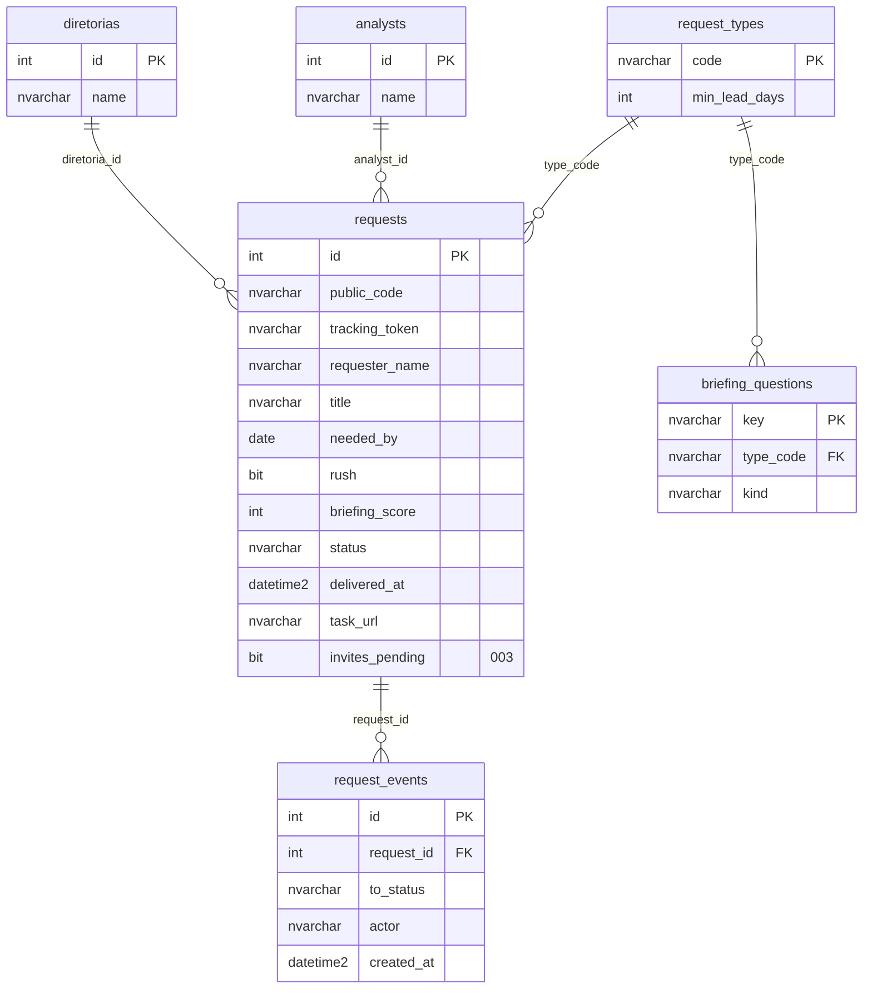
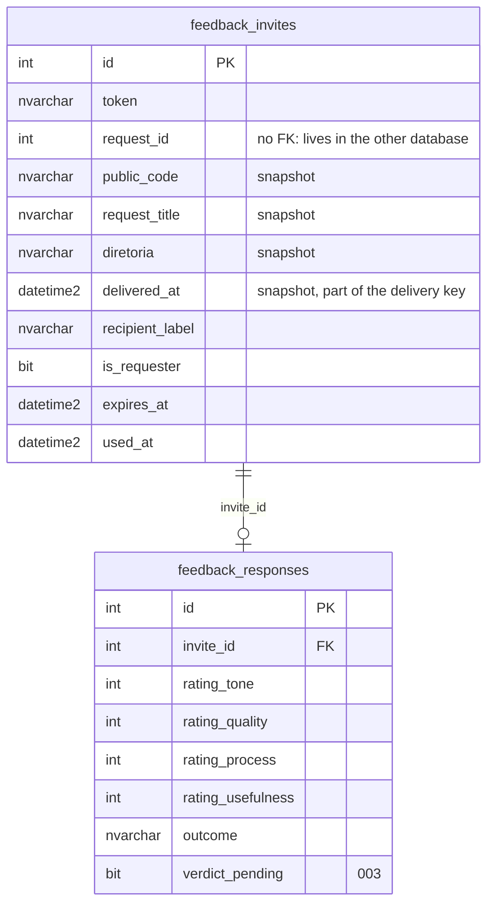

# AV Desk: Assignment 2 report

Split, ship and operate. Repository: https://github.com/Hoffalo/sdd-assignment-1. Live: https://lhoffmannui.z6.web.core.windows.net. The Assignment 1 report is kept as [REPORT_A1.md](REPORT_A1.md).

## 1. What changed

AV Desk takes video requests to BRASA's Audiovisual team (briefing → triage → production → delivery) and collects feedback after delivery. Assignment 1 ran it as one Flask process with SQLite and server-rendered pages. Two domains never imported each other and met only through events in `avdesk/services/seam.py` (ADR-2).

Assignment 2 cuts along that seam:
- the **requests** service owns intake, the lead-time rule, the lifecycle, the briefing catalog and the ClickUp task;
- the **feedback** service owns invites and answers;
- each service has its own container, its own SQL Server database and its own login;
- the pages became a static site in `ui/` that calls both services from the browser.

The domain packages moved with `git mv` and were otherwise unchanged except for imports. That is the evidence the seam was in the right place (ADR-6).

## 2. Architecture before and after

**Before (Assignment 1):** one process and one SQLite file. See [diagrams/architecture.svg](diagrams/architecture.svg).

```
browser ──HTML──▶ Flask app (web/) ──▶ RequestsFacade ─┐  seam.py (Observer)  ┌─ FeedbackFacade
                                       requests tables ├─ StatusChanged ─────▶│  feedback tables
                                                       │◀─ ResponseReceived ──┘
                                          one SQLite file, both domains' tables
```

**After (Assignment 2):**



Three things cross the seam, as ADR-2 predicted. The difference is that events became HTTP calls, because the brief forbids brokers:

| Flow | Side | How | When the other side is down |
|---|---|---|---|
| Delivery creates invites | Server (requests → feedback) | `POST /invites` with a snapshot of the delivered work and the recipients | Delivery is saved, `invites_pending` is set, and the admin page offers "Criar links agora" |
| Requester's verdict closes or reopens the request | Server (feedback → requests) | `POST /requests/{id}/verdict` | Answer is saved and the requester sees "Obrigado!"; `verdict_pending` is set and the admin page offers "Reenviar veredito" |
| Metrics | Client (browser joins both) | `GET /admin/metrics` on each | The requests half is shown, with a notice that feedback is unavailable |

The two services authenticate to each other with a 5-minute token signed with the shared `ADMIN_TOKEN_SECRET`. Its claim is different from the admin claim, so neither token can stand in for the other. Receivers are idempotent:
- the same delivery returns the existing invites;
- a verdict only moves a request that is still delivered.

So a retry is always safe (ADR-10).

## 3. Deployment



The initial setup is [infra/setup.sh](../infra/setup.sh), documented in [infra/README.md](../infra/README.md); after it, only the pipeline changes Azure. All resources are pay-per-use and scale to zero (ADR-8). The deploy step fails unless both `/health` endpoints report the new commit within 5 minutes. That window covers a container cold start plus a paused database resuming, which the services wait out with connection retries and backoff.

## 4. Databases, one per service





Both databases also hold `schema_migrations` (version, name, checksum, applied_at) and a one-row `health_probe` that `/health` writes to. The only link between the two databases is `feedback_invites.request_id`, a plain integer. Integrity at that seam is kept in code: invites carry a snapshot, unknown ids get a 404, and a repeated delivery is recognised (ADR-3, ADR-7).

## 5. Migrations, and the evidence on Azure

Each service applies `migrations/NNN_*.sql` in order at startup, each file in one transaction. They are recorded in `schema_migrations` with a checksum, so a second boot applies nothing and an edited file stops the service. Local log of a first boot:

```
requests-1 | INFO avdesk_requests.migrations: Applied migration 001_init
requests-1 | INFO avdesk_requests.migrations: Applied migration 002_health_probe
requests-1 | INFO avdesk_requests.migrations: Applied migration 003_invites_pending
```

**On Azure:** [EVIDENCE TO ADD after the second deployment. The first deployment applies 001–003. Requests and invites are then created through the live UI. A later pull request adds a migration that changes a table already holding rows. Here go the CD run link, the container log line "Applied migration 004_…", and row counts and a sample row before and after.]

## 6. Partial failure

With the feedback service stopped (`docker compose stop feedback`), the requests service keeps serving the inbox, the forms and tracking. Delivering a request still succeeds, and the admin page shows:

> Os links de avaliação ainda não foram criados: o serviço de avaliação não respondeu na entrega. **[Criar links agora]**

Once feedback is back, the button creates the links ("Links de avaliação criados."). In the other direction, with the requests service stopped, the requester still gets "Obrigado! Avaliação enviada.", and the admin page shows "Quem pediu já respondeu a avaliação, mas o veredito ainda não chegou a este pedido. **[Reenviar veredito]**". After the resend the request is "Concluído", and its timeline credits "avaliação". Both were verified in the browser and are automated in `tests/cross_seam` (4 journeys over real HTTP, with one outage on each side). [SCREENSHOTS TO ADD.]

`GET /health` on each service reports only its own database: `{"status": "ok", "db": "ok", "version": "<sha>"}`, or 503.

## 7. Pipeline and testing

One workflow. On every push and PR it runs four jobs:
- **specs:** `system.yaml` against `system.schema.json`, and both OpenAPI documents against the specification.
- **test:** per service, ruff plus pytest against a SQL Server container whose password is generated per run, with a 70% coverage gate.
- **cross-seam:** the journeys that run both services together.
- **build:** both images.

Deploy jobs run only on main and only after all four passed in the same run (ADR-9).

| Suite | Tests | Coverage |
|---|---|---|
| requests (unit + integration) | 262 | 98% |
| feedback (unit + integration) | 112 | 97% |
| cross-seam | 4 | — |

Pipeline evidence: [LINK TO ADD: successful CD run on main], [LINK TO ADD: a failed run, its cause and the fix].

Deliberately not tested: the browser JavaScript (checked by hand in each phase), Azure itself beyond the post-deploy health check, ClickUp's real API, and performance.

## 8. AI disclosure

I acknowledge the use of Anthropic's Claude, through Claude Code (Claude Opus 5.5) in the Claude desktop app, to plan and carry out the split. The prompts used include:
- pasting the Assignment 2 brief and approving a six-phase plan;
- asking it to split the monolith into two services on SQL Server with versioned migrations;
- asking it to turn the templates into a static UI with JSON APIs;
- asking it to make the services call each other with designed failure;
- asking it to write the Dockerfiles, compose file, OpenAPI documents, `system.yaml`, the GitHub Actions pipeline and the Azure setup script, and to run the setup with my Azure login after I approved it.

The output of these prompts was used to:
- write the code, tests, infrastructure files and documentation, which I reviewed and tested in the running app;
- shape the decisions recorded in ADR-6 to ADR-10;
- draft this report.

The prompt-by-prompt log, infrastructure files included, with my own explanation of how each part works, is in [AI_USAGE.md](../AI_USAGE.md).
