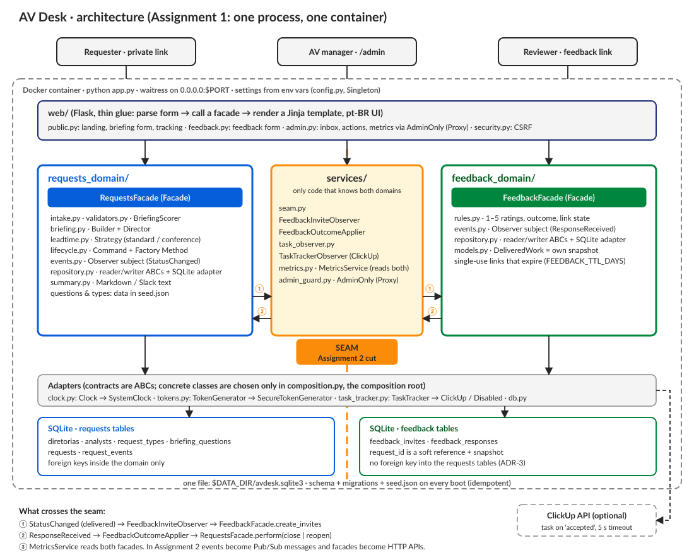
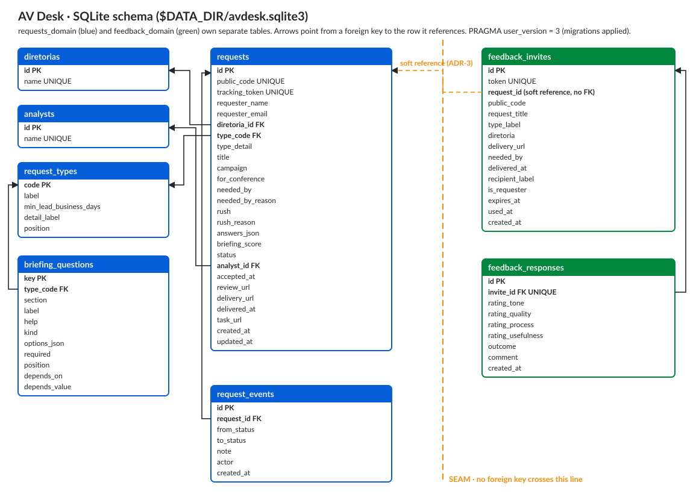

# AV Desk: Assignment 1 report

**Lorenzo Hoffmann** · Software Development and DevOps · IE University · repository: [github.com/Hoffalo/sdd-assignment-1](https://github.com/Hoffalo/sdd-assignment-1)

## 1. The project

BRASA is the largest association of Brazilian students abroad. As its Audiovisual manager, I receive requests for videos (teasers, institutional videos, social videos outside the editorial calendar) through scattered Slack threads. The same five problems repeat: vague asks, deadlines that arrive too late, tone that is wrong and only noticed at delivery, no visibility on progress, and no structured feedback afterwards.

AV Desk is the tool that fixes those five problems. A board member fills a briefing whose questions adapt to the type of video and to their answers. A business-day rule flags requests that give too little notice. The request moves through a lifecycle in my triage inbox, which creates a ClickUp task when it is accepted. Cuts are reviewed on Frame.io from the requester's tracking page. On delivery, single-use feedback links collect ratings, and the requester's verdict closes or reopens the request. A metrics page turns all of it into turnaround, on-time rate and quality by type and diretoria.

Assumed scale (an assumption used for design decisions, not a measurement): about 40 board members as requesters, a few hundred requests a year. That scale is why there are no user accounts (unguessable links instead) and no caching layer.

## 2. SDLC model and goals

**Model: iterative and incremental, with test-driven slices.** Each slice was one business rule or layer, built red → green → refactor and committed separately (configuration, lead time, briefing, lifecycle, repositories, facades, feedback, seam, web). Iterative fits because the business requirements were still being validated with the AV team: lead times, the question set and the review flow all changed after the first working version, and each change went through the same test-first loop. A waterfall plan would have frozen a question set that real use changed within a week.

**SMART goals, and what happened.**

| Goal (specific, measurable, time-bound) | Outcome |
|---|---|
| G1. The container contract (`container/run.sh`) passes by 2026-10-10. | Late: the application was ready on 2026-10-10, but Docker Desktop could not be started from the terminal; the first passing run was 2026-10-17, re-run on 2026-10-18 after the database changes. |
| G2. Both domains working end to end through SQLite by 2026-10-10. | Met: both domains, the seam and all pages were built on 2026-10-10. |
| G3. ≥70% coverage of core business logic by 2026-10-12. | Exceeded: 97% overall, 99–100% on the lead-time, lifecycle, facade, feedback-rule, seam and metrics modules (208 tests). |
| G4. Five ADRs across ≥3 commit dates by 2026-10-12. | Partly met: ADR-1–3 on 2026-10-10, ADR-4 on 2026-10-17, ADR-5 on 2026-10-18; three dates, but later than planned. |
| G5. 12+ commits over 6+ days, no day above 40%. | Not met: 40+ commits, but over 4 days, with 2026-10-10 holding more than half (the professor allowed the day rule to flex). |

**Where practice deviated, and why.** The plan spread work over four days; in practice the first version was built in one day and then refined after real use. Testing the running app surfaced changes no test had predicted: follow-up questions (an "Outro" tone needs a description; Instagram needs the publishing account), removing three questions, a review step on Frame.io, and an admin panel that showed two identical message boxes. It also exposed a structural gap: seed data only loaded into empty tables, so question changes could never reach a database already in use. That led to numbered migrations and a seed-driven catalog. Being iterative made these late changes cheap, because each one landed in the layer that owned it.

## 3. Architecture

The app is one Flask process served by waitress, in one container, with one SQLite file. The code is layered so that business rules never touch HTTP or SQL:

- **`web/`** only parses forms, calls a facade and renders a Portuguese template.
- **`requests_domain/`** owns asking for and producing a video (briefing, lead time, lifecycle). **`feedback_domain/`** owns post-delivery feedback. Each has one Facade as its public entry point and its own tables, and neither imports the other.
- **`services/`** is the only code that knows both domains. **`composition.py`** is the composition root: the only place concrete classes are chosen and observers attached.

**The seam** runs between the two domains, through `services/seam.py`, and exactly three things cross it:

1. A `StatusChanged` event (delivered) carrying an immutable snapshot, which creates feedback invites.
2. A `ResponseReceived` event, which closes or reopens the request (only the requester's answer counts).
3. Read-only metrics over both facades.

In Assignment 2 the events become Pub/Sub messages and the facades become HTTP APIs (ADR-2). The design applies the class patterns where each solves a real problem here: Strategy for lead-time policies, Command and Factory Method for status changes (with undo), Builder for the briefing, Observer at the seam, Facade per domain, Adapters over time, tokens, ClickUp and SQLite, a protection Proxy for the admin area, and a Singleton for configuration only. `docs/DESIGN_NOTES.md` states the problem, reason and trade-off of each.

## 4. Database

Each domain owns its tables. Foreign keys are used **inside** a domain and never **across** it. `feedback_invites.request_id` is a soft reference, and each invite stores a snapshot of the delivered request (ADR-3), so the feedback tables can move to their own database in Assignment 2. Fields that rules, filters and metrics read are real columns; the type-dependent briefing answers are JSON, because the question set is data in `seed.json`.

Startup is idempotent:

- `CREATE TABLE IF NOT EXISTS` creates what is missing.
- An append-only list of migrations, tracked in `PRAGMA user_version`, upgrades older databases.
- Request types and questions follow `seed.json` by natural key, while diretorias and analysts are seeded once, because requests point at them by id.

The container check confirms that a second boot changes no row counts.

## 5. README and setup

The repository [README](../README.md) is part of this submission. It covers:

- running directly (`python app.py`) and with `docker build` / `docker run`;
- every environment variable with its default;
- the SQLite path (`$DATA_DIR/avdesk.sqlite3`);
- the coverage command and result;
- the passing `container/run.sh` output.

Each code directory has its own README, and `docs/GUIDE.md` explains the whole system top to bottom.

## 6. Testing

208 pytest tests, 97% line coverage of `avdesk/`. The pyramid is:

- **128 unit tests (62%):** rules in isolation, with an injected `FixedClock`, predictable tokens and `mocker` mocks;
- **59 integration tests (28%):** real SQLite in a temporary folder (repositories, migrations, catalog sync, facades, the real seam wiring);
- **21 end-to-end tests (10%):** whole journeys through Flask's test client.

The unit share sits below the slides' 70–80% on purpose. The riskiest code (atomic status transitions guarded by the expected status, single-use links, idempotent startup, the missing cross-domain foreign key) only proves anything against a real database (ADR-4). Templates and JavaScript are covered only indirectly.

## 7. AI disclosure

I acknowledge the use of Anthropic's Claude, through the Claude app and Claude Code (Claude Opus 5.5), to help build the platform and to gather the business logic and information about BRASA that it had from my day-to-day work with it at BRASA. The prompts used include:

- asking Claude to collect everything it knew about BRASA and how we work there;
- explaining the two domains and the product I wanted, and asking for a handoff document that would let Claude Code apply that context;
- sharing BRASA's visual identity manual so the front end follows it;
- asking Claude Code to build the application following the class slides on SOLID, design patterns and testing;
- asking for explanations of the plan and of each part of the system, and for a full project guide and per-directory documentation;
- reporting changes found while testing the app, and asking for the ADRs, diagrams and this report to be drafted.

The output of these prompts was used to:

- write the application code, tests and documentation, which I reviewed, tested in the running app and corrected through further prompts;
- shape the design decisions recorded in `ADR.md`;
- draft this report.

The prompt-by-prompt log, with what I accepted, modified or rejected and my own explanation of how each part works, is in `AI_USAGE.md`.
